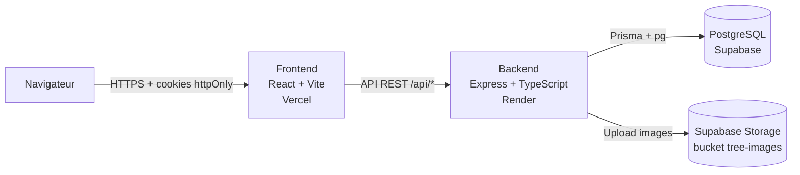

# GreenRoots - Application web (frontend)

> Interface de GreenRoots, plateforme e-commerce de reforestation : le visiteur choisit des arbres, passe commande, et GreenRoots se charge de les planter.

Projet de groupe réalisé dans le cadre du titre professionnel **Concepteur Développeur d'Applications (CDA)** - [O'clock](https://oclock.io), promotion Jakarta.

---

## Sommaire

- [GreenRoots - Application web (frontend)](#greenroots---application-web-frontend)
  - [Sommaire](#sommaire)
  - [1. Contexte et périmètre](#1-contexte-et-périmètre)
    - [MVP livré](#mvp-livré)
  - [2. Architecture](#2-architecture)
  - [3. Stack technique](#3-stack-technique)
  - [4. Démarrage rapide](#4-démarrage-rapide)
    - [Prérequis](#prérequis)
    - [Installation](#installation)
    - [Variables d'environnement](#variables-denvironnement)
    - [Comptes de démonstration (issus du seed du backend)](#comptes-de-démonstration-issus-du-seed-du-backend)
    - [Scripts](#scripts)
  - [5. Routes](#5-routes)
  - [6. Authentification côté client](#6-authentification-côté-client)
  - [7. Panier et commande](#7-panier-et-commande)
  - [8. Accessibilité](#8-accessibilité)
  - [9. Données personnelles et RGPD](#9-données-personnelles-et-rgpd)
  - [10. Qualité et intégration continue](#10-qualité-et-intégration-continue)
    - [Contrôles de qualité](#contrôles-de-qualité)
    - [Intégration continue](#intégration-continue)
  - [11. Déploiement](#11-déploiement)
  - [12. Organisation d'équipe et conventions](#12-organisation-déquipe-et-conventions)
  - [Documentation complémentaire](#documentation-complémentaire)
  - [Équipe](#équipe)

---

## 1. Contexte et périmètre

GreenRoots permet à des particuliers éco-conscients et à des entreprises responsables de financer la plantation d'arbres. Le détail des besoins, personas, contraintes et de l'analyse des risques est dans le **cahier des charges** .

Ce dépôt contient l'**application web** (SPA React). Elle consomme l'API REST du dépôt backend.

### MVP livré

| Profil | Fonctionnalités |
| --- | --- |
| **Visiteur** | Page d'accueil, catalogue, fiche détail d'un arbre, panier, inscription, connexion, pages légales (mentions légales, confidentialité, CGV), contact |
| **Utilisateur connecté** | Tunnel de commande (paiement par virement ou chèque), confirmation, historique et détail des commandes, modification du profil, suppression du compte |
| **Administrateur** | CRUD des arbres (avec upload d'image), consultation des commandes, validation / annulation d'une commande |

---

## 2. Architecture

L'application suit une architecture **3 tiers** : présentation (ce dépôt), logique métier (API) et données (base PostgreSQL). Front et back sont deux dépôts distincts qui communiquent par API REST (JSON). Le front n'accède jamais directement à la base.



Organisation du code (`src/`) :

```
pages/         Une page par route
components/    Composants réutilisables, regroupés par domaine
context/       AuthProvider, CartProvider, TreesProvider
hooks/         Logique métier réutilisable (commandes, recherche, checkout…)
routes/        AppRoutes (React Router) + garde RequireAdmin
utils/         fetchWithAuth, persistance du panier
@types/        Types partagés
```

---

## 3. Stack technique

| Domaine | Technologies |
| --- | --- |
| **Frontend (ce dépôt)** | React 19, TypeScript, Vite, React Router, CSS (avec reset) |
| **Backend** | Node.js, Express, TypeScript, Prisma |
| **Données** | PostgreSQL et Storage (Supabase) |
| **Qualité** | ESLint, vérification TypeScript au build |
| **Outils d'équipe** | Git / GitHub, Trello |
| **Hébergement** | Vercel (front), Render (API), Supabase (base et images) |

---

## 4. Démarrage rapide

### Prérequis

- Node.js **22.x** et npm
- Git
- L'**API GreenRoots** démarrée en local (voir le README du dépôt backend) ou une URL d'API déployée

### Installation

```bash
git clone <url-ssh-du-depot>
cd projet-greenroots-front
npm install
cp .env.example .env
npm run dev
```

L'application est disponible sur `http://localhost:5173`.

### Variables d'environnement

Le fichier `.env` n'est **jamais versionné** ; seul le `.env.example` l'est.

| Variable | Description | Exemple |
| --- | --- | --- |
| `VITE_API_URL` | URL de base de l'API (sans slash final) | `http://localhost:3000` |

> Côté API, la variable `FRONTEND_URL` doit correspondre exactement à l'origine de ce front (`http://localhost:5173` en local), sinon les requêtes sont bloquées par CORS.

### Comptes de démonstration (issus du seed du backend)

| Rôle | Email | Mot de passe |
| --- | --- | --- |
| Utilisateur | `julien.dupont@example.com` | `User123!` |
| Utilisateur | `sofia.martin@example.com` | `User123!` |

> **Attenttion** Ces comptes n'existent que pour la démonstration (seed de développement). Ils ne doivent jamais être présents sur une base de production.

### Scripts

| Commande | Rôle |
| --- | --- |
| `npm run dev` | Serveur de développement Vite |
| `npm run build` | Vérification TypeScript + build de production |
| `npm run preview` | Prévisualisation du build |
| `npm run lint` | ESLint |

---

## 5. Routes

| Route | Accès | Page |
| --- | --- | --- |
| `/` | Public | Accueil |
| `/catalog` | Public | Catalogue (recherche et tri) |
| `/catalog/:slug` | Public | Détail d'un arbre |
| `/register`, `/login` | Public | Inscription, connexion |
| `/cart` | Public | Panier |
| `/cart/order` | Connecté | Validation de la commande |
| `/cart/order/:id` | Connecté | Confirmation de commande |
| `/me` | Connecté | Mon compte |
| `/me/profil` | Connecté | Mes informations |
| `/me/orders` | Connecté | Historique des commandes |
| `/admin` | Admin | Tableau de bord |
| `/admin/trees` | Admin | Gestion du catalogue |
| `/admin/orders` | Admin | Gestion des commandes |
| `/legal-notice`, `/privacy-policy`, `/cgv`, `/contact` | Public | Pages légales et contact |
| `*` | Public | Page d'erreur 404 |

Les routes d'administration sont protégées côté client par le composant `RequireAdmin`, qui améliore l'expérience utilisateur sans garantir la sécurité. La protection réelle est assurée côté API par le middleware `verifyAdmin`.

---

## 6. Authentification côté client

L'authentification repose sur des **cookies `httpOnly`** posés par l'API : les tokens ne sont jamais accessibles au JavaScript, et le front ne les stocke nulle part.

- Toutes les requêtes authentifiées passent par `fetchWithAuth` (`utils/`), qui envoie `credentials: "include"`.
- Quand l'access token expire (15 minutes), l'API répond `401` : `fetchWithAuth` appelle `/api/auth/refresh` puis **rejoue une seule fois** la requête d'origine.
- Au chargement de l'application, `AuthProvider` tente un refresh pour **restaurer la session**.
- Une seule session active par utilisateur (rotation du refresh token côté API).

Le détail des mesures de sécurité (hachage, rate limiting, CORS…) est documenté dans le README du backend.

---

## 7. Panier et commande

- Le **panier n'est pas stocké en base** : il est conservé dans le `localStorage` du navigateur (décision du Sprint 0), via `CartProvider` et les utilitaires de persistance.
- La commande est créée à partir du panier (`POST /api/orders`). Le **paiement est simulé** (virement ou chèque) : c'est l'administrateur qui valide ou annule la commande.
- **Une seule commande en attente par utilisateur** : si l'API répond `409`, le front propose de reprendre la commande en attente.
- Les arbres inexistants (`404`) ou indisponibles (`422`) sont refusés par l'API.
- Upload d'image côté admin : JPEG, PNG, WebP, **5 Mo maximum**.

---

## 8. Accessibilité

Le frontend a été construit en gardant l'accessibilité en tête :

| Bonne pratique | Mise en œuvre |
| --- | --- |
| HTML sémantique | Utilisation de `<nav>`, `<main>`, `<header>`, `<footer>` plutôt que des `<div>` génériques |
| Étiquetage des composants interactifs | `aria-label` sur les boutons icônes (menu compte, fermeture de modale, ajout au panier…) et `aria-labelledby` sur les sections de formulaire |
| Rôles ARIA | `role="dialog"` pour les modales, `role="alert"` pour les messages d'erreur, `role="status"` pour les zones de chargement, `role="group"` pour le sélecteur de quantité |
| Focus clavier | États `:focus-visible` définis en CSS sur les éléments interactifs |
| Formulaires | Association labels / champs, messages d'erreur annoncés via `role="alert"` |
| Images | Attribut `alt` sur les visuels porteurs de sens (photos d'arbres, logo) |

---

## 9. Données personnelles et RGPD

| Principe RGPD | Côté front |
| --- | --- |
| Transparence | Page **Politique de confidentialité** (`/privacy-policy`), avec date de dernière mise à jour |
| Minimisation des données | Le formulaire d'inscription ne demande que prénom, nom et e-mail ; aucune donnée bancaire n'est saisie (paiement simulé) |
| Droit à l'effacement | Suppression du compte depuis l'espace « Mon compte », avec confirmation par mot de passe |
| Sécurité des données | Aucun token dans le `localStorage` : seuls des cookies `httpOnly` gérés par l'API |

L'implémentation côté serveur (conservation des commandes détachées de l’utilisateur, hachage…) est décrite dans le README du backend.

---

## 10. Qualité et intégration continue

### Contrôles de qualité

```bash
npm run lint     # ESLint
npm run build    # Vérification TypeScript + build de production
```

À ce stade, le projet ne comporte pas de tests automatisés : la qualité repose sur le typage strict (TypeScript), l'analyse statique (ESLint) et la revue de code.

### Intégration continue

Il n'y a pas, à ce stade, de pipeline CI automatisé. La qualité est garantie **manuellement, avant chaque merge** :

1. Le contributeur lance en local `npm run lint` et `npm run build`
2. La Pull Request est ouverte vers `develop` et passe par une **revue de code obligatoire** (voir [Organisation d'équipe](#12-organisation-déquipe-et-conventions))
3. Le merge n'est validé qu'après retour positif du relecteur

---

## 11. Déploiement

| Composant | Hébergeur | URL | Notes |
| --- | --- | --- | --- |
| Frontend | Vercel | `https://greenroots-app.vercel.app` | Variable `VITE_API_URL` à renseigner ; commande de build : `npm run build` |

Points d'attention en production :

- `VITE_API_URL` doit pointer vers l'API déployée sur Render (sans slash final).
- Front et back étant sur des domaines différents, l'API doit tourner avec `NODE_ENV=production` (cookies `secure` + `sameSite=none`) et `FRONTEND_URL` égal à l'origine exacte du front déployé.

---

## 12. Organisation d'équipe et conventions

Projet mené en **méthode agile (Scrum)**, en sprints : conception (Sprint 0), développement, déploiement et recettage. Daily quotidien, tableau Trello tenu à jour, revue de code obligatoire avant chaque merge.

| Membre | Rôle Scrum | Référent technique |
| --- | --- | --- |
| Maxime | Product Owner | Frontend |
| Selim | Lead Dev | Backend |
| Charbel | Scrum Master | Base de données |

Répartition du travail **par fonctionnalité** (chaque membre intervient sur toutes les couches), les référents garantissant la cohérence de leur domaine.

**Git**

```
main      ← production
  ↑
develop   ← intégration
  ↑
feature/… ← une branche par fonctionnalité
```

Intégration dans `develop` par **Pull Request** avec revue. Commits atomiques suivant la convention.

**Code**

- Code et identifiants en **anglais**
- `camelCase` pour variables et fonctions, `PascalCase` pour types et composants
- Exports nommés privilégiés
- ESLint au vert et build sans erreur avant toute PR

---

## Documentation complémentaire

- **Cahier des charges** : besoins, personas, user stories, analyse des risques
- **Wireframes, maquettes et charte graphique** : livrables du Sprint 0
- **README du backend** : API REST, base de données, sécurité, règles métier

## Équipe

Maxime, Selim et Charbel - formation CDA O'clock, promotion Jakarta.
